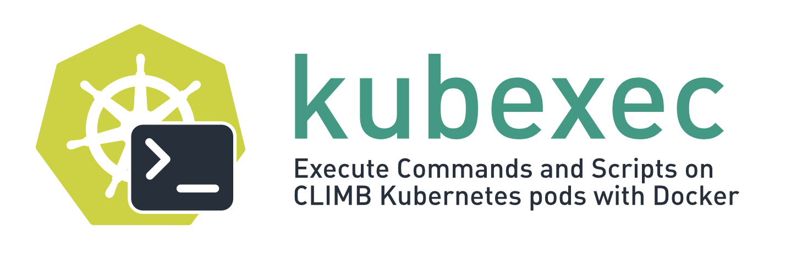

# kubexec

[](https://pypi.org/project/kubexec/)
[](https://pypi.org/project/kubexec/)
[](https://github.com/telatin/kubexec/releases)
[](https://github.com/telatin/kubexec/actions/workflows/tests.yml)



Execute commands and scripts on Kubernetes pods with Docker access.

Designed for use in [CLIMB Notebooks](https://docs.climb.ac.uk/).

## Installation

```bash
pip install -e .
```

## Usage

```bash
kubexec [-h] [-d DOCKER_IMAGE] [-n NAMESPACE] [-p POD_NAME]
        [-m MEMORY] [-c CPU] [-w WORKDIR] [-v VOLUME_MOUNT]
        [--config CONFIG] [--context CONTEXT] [--create-pod]
        [--cleanup | --no-cleanup] [--verbose] [--dry-run] TARGET

kubexec --list-jobs [--all-users]
kubexec --cleanup-old HOURS [--all-users]

kuberlist [--all] [--running] [--kubexec [--all-users]] [--watch]
          [-n NAMESPACE] [--config CONFIG] [--context CONTEXT]
```

## Examples

```bash
# Run a simple command
kubexec 'echo "Hello, Kubernetes!"'

# Use specific Docker image
kubexec -d python:3.9 'python -c "import sys; print(sys.version)"'

# Run with resource limits
kubexec -m 4Gi -c 2 'stress --cpu 2 --timeout 60s'

# Execute script file
kubexec ./my_script.sh

# Use existing pod
kubexec -p my-existing-pod 'ls -la'

# Volume mounting
kubexec -v /host/data:/pod/data 'ls /pod/data'

# Save output to local files (works like local commands; from a non-shared
# directory the file ends up in the per-run folder printed at start)
kubexec "ls -la > output.txt"

# Bioinformatics example with SPAdes genome assembler
# This will create spades-out/ in your current working directory (if it is under
# /shared/team or /shared/public; otherwise in the per-run folder printed at start)
kubexec -d community.wave.seqera.io/library/spades:4.1.0--77799c52e1d1054a \
    "spades.py -1 tests/reads/s_6_1.fastq.gz -2 tests/reads/s_6_2.fastq.gz -o spades-out"
```

## Where jobs run

Jobs always have `/shared/team` and `/shared/public` mounted. The directory a job runs in is
chosen as follows:

1. `-w/--workdir`, if given. It supports `{user}` (your login name) and `{run}` (a unique id
   per run), and relative paths are resolved against the directory in point 2 or 3.
2. The current directory, if it is under `/shared/team` or `/shared/public`.
3. Otherwise (e.g. your Jupyter home, which jobs cannot see) a new folder per run:
   `/shared/team/kubexec/work/<you>/<run-id>`. The folder is printed at start and removed
   when the job finishes if it was left empty, so outputs never overwrite each other.

```bash
kubexec -w /shared/team/myproject/out 'make results'   # run in an explicit directory
kubexec -w 'results/{run}' 'make results'              # a unique subfolder per run
```

## Jobs and users

Every job is labelled with your `$JUPYTERHUB_USER` (falling back to `$USER`). On a shared
namespace this keeps your jobs separate from other people's:

```bash
kubexec --list-jobs                 # your jobs
kubexec --cleanup-old 24            # delete your jobs older than 24 hours
kubexec --list-jobs --all-users     # everyone's jobs
kubexec --cleanup-old 24 --all-users

kuberlist --kubexec                 # your kubexec pods
kuberlist --kubexec --all-users     # everyone's kubexec pods, with a USER column
```

Jobs created before 0.8.0 carry no user label: they are only listed or cleaned with
`--all-users` (shown as user `unknown`).

## Configuration

Configuration is personal and lives in `~/.config/kubexec/config.yaml`, created with the
defaults on first run (nothing is written to `/shared/team`, and older shared configs are no
longer read). Use `--config FILE` to read another file; this applies to `--list-jobs`,
`--cleanup-old` and `kuberlist` too.

| Key | Environment variable | Default |
|---|---|---|
| `docker_image` | `KUBEXEC_DOCKER_IMAGE` | `ubuntu:latest` |
| `namespace` | `KUBEXEC_NAMESPACE` | auto-detected |
| `memory` / `cpu` | `KUBEXEC_MEMORY` / `KUBEXEC_CPU` | `1Gi` / `1` |
| `default_workdir` | `KUBEXEC_DEFAULT_WORKDIR` | `/shared/team/kubexec/work/{user}/{run}` |
| `workdir` | `KUBEXEC_WORKDIR` | `/tmp` (container start directory only) |
| `cleanup` | `KUBEXEC_CLEANUP` | `true` |
| `verify_ssl` | `KUBEXEC_VERIFY_SSL` | `true` |
| `timeout` | `KUBEXEC_TIMEOUT` | `3600` (seconds) |
| `verbose` | `KUBEXEC_VERBOSE` | `false` |

`default_workdir` must be an absolute path. Drop `{run}` from it to share one persistent
folder between runs (it is then never removed automatically).

## Testing

```bash
pip install -e '.[test]'

pytest                      # unit tests; CLIMB tests run too when CLIMB is detected
pytest tests/unit           # unit tests only (no cluster needed, runs anywhere)
pytest -m "not e2e"         # on CLIMB, skip tests that create real jobs
KUBEXEC_TEST_CLIMB=0 pytest # force-skip the CLIMB suite (=1 forces it on)
```

CLIMB is detected by the in-cluster service account plus `/shared/team` and `/shared/public`
being mounted. Tests marked `xfail` document known bugs and will fail loudly (strict) once fixed.
